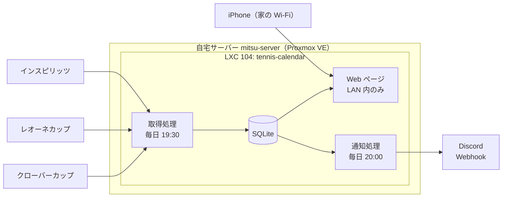

# 草トーナメント横断カレンダー 基本設計（v1.0）

要求は [REQUIREMENTS.md](./REQUIREMENTS.md) を参照。

## 1. 全体構成



## 2. 実行基盤

自宅サーバー（home-server リポジトリ）に、専用の LXC を1台追加する。

| 項目 | 値 | 根拠 |
|---|---|---|
| ゲスト | LXC 104 `tennis-calendar` | home-server の原則「1 サービス = 1 ゲスト」「既定は LXC」 |
| 割り当て | 512 MB / 1 コア（cpulimit 1）/ 8 GB | 1日1回の取得と小さな Web ページのみ。原則「上限を必ず付ける」 |
| IP | `192.168.11.104/24`（静的） | 原則「サービスのアドレスは固定する」 |
| 公開範囲 | LAN 内のみ（`http://192.168.11.104:8080`） | home-server の方針「既定は LAN 内のみ」 |

外出先からの閲覧はしない。通知に元ページへのリンクを載せるため、外では Discord から直接申し込める。

作成前に home-server の `docs/guests.md`（台帳・配分）と `docs/network.md`（ポート）へ1行ずつ足す。

## 3. 技術選定

| 対象 | 選定 | 理由 |
|---|---|---|
| 言語 | TypeScript（Node.js 24） | 本リポジトリが既に pnpm / Node 24 を使っている。モノレポで揃える |
| HTML 解析 | cheerio | clover・leone は静的 HTML。ヘッドレスブラウザは 512 MB の LXC には重い |
| inspirits の取得 | `POST /ajax/reservations/calendar` を直接呼ぶ | 一覧はこの API から読み込まれている（2026-10-12 確認）。一覧ページで発行される CSRF トークンと Cookie が要る。1ページ20件のページ送り（同日6ページ）で、間隔2秒・上限10ページで取る |
| 保存 | SQLite | 1プロセス・1ファイルで足りる。控えは vzdump に乗る |
| Web | Hono で SSR | 絞り込みをクエリ文字列で受け、サーバー側で描画する。クライアント側のビルドが不要 |
| 定期実行 | systemd timer | LXC 内で完結する。cron より失敗時のログが追いやすい |
| 通知 | Discord Webhook | Bot の常駐が不要。URL 1つで送れる |

## 4. データモデル

### tournaments（大会）

| 列 | 内容 |
|---|---|
| id | `{サイトID}:{サイト内の大会キー}` |
| site | サイト ID（`clover` / `leone` / `inspirits`。要求定義7章） |
| name | 大会名 |
| date / start_time | 開催日・開始時刻 |
| venue | 会場 |
| event | 種目（正規化後: 男子シングルス 等） |
| level | レベル（正規化後、5章） |
| level_raw | サイト上の表記 |
| status | 受付前 / 受付中 / 空き少 / 満員 / 中止 / 不明（6章のサイト別対応） |
| url | 元ページ |
| first_seen_at / last_seen_at | 初回・最後に一覧で見かけた日時。一覧から消えた大会は last_seen_at が古いまま残る |

### status_history（状態の変化）

通知の判定に使う。取得のたびに前回と比べ、変わったものだけ1行足す。

### holidays（祝日）

内閣府の「国民の祝日」CSV を取得のたびに入れ直す。

### notify_runs（通知の実行記録）

「前回通知以降の変化」の起点に使う。

### crawl_runs（取得の実行記録）

サイトごとの成否と件数。件数0件や失敗が続いたら通知に載せる（NFR-4）。

## 5. 正規化

### レベル

| 正規化後 | clover | leone | inspirits |
|---|---|---|---|
| 初級 | 初級 | 初級・超初級 | 初級・超初級 |
| 初中級 | 初中級・初中級以下 | 初中級 | 初中級・初級～初中級 |
| 中級 | 中級・中級以下 | 中級 | 中級 |
| 中上級 | 中級以上 | 中上級 | 中上級 |
| オープン | オープン | オープン（グレードA〜C） | オープン |

2026-10-12 に3サイトの実データで確認した。範囲表記（`初級～初中級`）は上側に寄せる。

### 種目

inspirits の試合一覧には練習会・講座・オフ会も混ざる。これらは「その他」に分類し、試合と区別する。

### 状態

| 正規化後 | clover（申込み欄） | leone | inspirits（空き情報） |
|---|---|---|---|
| 受付前 | 「○/○より申込み開始」 | — | — |
| 受付中 | 申込みはこちら | — | 在庫あり |
| 空き少 | — | — | 在庫希少 |
| 満員 | 満員・キャンセル待ち・締切 | — | 在庫切れ |
| 中止 | 開催中止 | — | — |
| 不明 | 上記以外 | 常に不明 | 上記以外 |

leone は一覧ページに空き状況が無い。詳細ページは別ドメイン（leone.tokyo）のアプリで、取得の手間に見合わないため取らない。

### 休日

土日と、内閣府の「国民の祝日」CSV に載っている日。

## 6. 通知

毎日 20:00 に、既定の絞り込み（男子シングルス・休日・中級/中上級）に合う大会の、前回通知以降の変化を1通にまとめて送る。

| 区分 | 判定 |
|---|---|
| 新着 | 前回通知以降に初めて取得した |
| 申込開始 | 状態が「受付前」から「受付中」になった |
| 空き発生 | 状態が「満員」から「受付中 / 空き少」になった（leone は状態が取れないため対象外） |
| 取得失敗 | サイトの取得失敗、または0件 |

変化が無い日は送らない。

## 7. 画面

一覧1画面のみ。左のサイドバーに絞り込み、右に開催日順の大会一覧を置く。
絞り込みを上部に置くと一覧の開始位置が大きく下がるため、サイドバーにした（2026-10-12 ユーザー要望）。

幅 767px 以下（iPhone）は横に並べる幅が無いため、サイドバーを画面外に置き、
「絞り込み」ボタンで左から引き出す。JavaScript を使わず、チェックボックスの状態で開閉する。

配色はダークのみ（2026-10-12 ユーザー要望）。真っ黒の背景に白文字だと目がちらつくため、
背景を墨色（`#1e2227`）、文字を灰白（`#d5d9de`）にしてコントラストを抑える。
状態の色も含め、文字と背景のコントラスト比は 4.5:1 以上を保つ。大会は余白を取ったカードで1件ずつ区切る。

| 絞り込み | 形式 | 既定値 |
|---|---|---|
| 期間 | 開始日・終了日 | 今日〜60日後 |
| 曜日 | 休日 / 平日（複数選択） | 休日 |
| 種目 | 複数選択 | 男子シングルス |
| レベル | 複数選択（5章の正規化後） | 中級・中上級 |
| 空き | 満員・中止を隠す | 隠す |
| サイト | 複数選択 | すべて |

絞り込みはフォームの GET 送信でクエリ文字列に載せる。条件ごとに URL が決まるため、
iPhone のホーム画面に条件付きで追加できる。JavaScript は使わない。

各行に表示する項目: 開催日（曜日）・開始時刻・大会名・会場・種目・レベル（サイト上の表記も併記）・状態・元ページへのリンク。

## 8. ディレクトリ構成（モノレポ）

```
tennis/
├── package.json            # pnpm workspace のルート
├── pnpm-workspace.yaml     # TournamentCalendar を追加
├── TennisAnalyser/
└── TournamentCalendar/
    ├── docs/
    ├── src/
    │   ├── sites/          # サイトごとの取得処理（clover・leone・inspirits）
    │   ├── normalize/
    │   ├── db/
    │   ├── web/
    │   └── notify/
    ├── src/cli/            # 手動実行の入口（pnpm crawl）
    ├── test/fixtures/      # 各サイトの HTML の控え（2026-10-12 取得）
    └── deploy/             # systemd unit・timer、install.sh
```

## 9. 配置と運用

| 項目 | 内容 |
|---|---|
| コード | LXC 104 の `/opt/tennis` に本リポジトリを clone。Node 24 が TypeScript をそのまま実行するため、ビルド工程は無い |
| 設定 | `/etc/tournament-calendar.env`（600、git 管理外）。Discord の Webhook URL はここにだけ置く |
| データ | `/var/lib/tournament-calendar/tournaments.sqlite` |
| 時刻 | 記録・表示・「今日」の判定はすべて日本時間。LXC のタイムゾーン設定に依存しない |
| 導入 | `TournamentCalendar/deploy/install.sh` |

### 通知の初回

最初の通知は送らず、起点の記録だけをする。取得済みの数百件がすべて「新着」として届くのを避けるため。

### 新着から外すもの

満員・中止の新着は申し込めないので知らせない。空きが出れば「空き発生」で届く。

## 10. 未決事項

なし（2026-10-12 時点）
